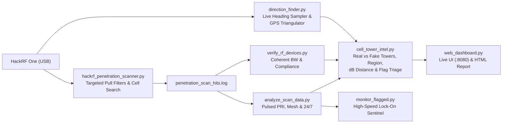

# 📡 HackRF Cell Tower, Direction Finder & Smart Spectrum Intelligence Suite


-blue?style=flat-square)


A standalone, **zero-dependency Python 3** RF spectrum intelligence, cellular authenticity, and direction-finding suite built around `hackrf_sweep` for the **HackRF One** (1 MHz – 3 GHz).

Designed for RF researchers, security analysts, and spectrum auditors, it goes beyond raw power sweeps to **distinguish likely real cell towers from suspected fake/rogue base stations**, **filter out regional background noise so you only pull target frequencies**, **estimate transmitter distance from received dB**, **determine incoming signal compass bearings via a live 360° Direction Finder & GPS Triangulator**, and **triage genuine research flags from benign local traffic** based on your geographic location.

---

## ✨ Key Capabilities

| Capability | Description |
| :--- | :--- |
| **📡 Real vs. Fake Cell Tower Detector** | Scores cellular-band emitters (`0–100` Authenticity vs. Fake Risk) using regional 3GPP Downlink/Uplink plans, FDD duplex pairing, channel bandwidth (wideband 4G/5G OFDM vs. narrowband ~200 kHz spikes in 2G-sunset regions), temporal stability (24/7 macro vs. pulsed/pop-up transient), close-range RSSI overpowering, and optional **OpenCelliD / FCC** real-tower cross-referencing. |
| **🎯 Targeted Frequency Pull Filters** | Pull **only** the signals you are looking for (`--mode cell`, `--mode cell-pulsed`, `--mode pulsed`, `--only-cell`, `--only-pulsed`, `--exclude-wifi`, `--exclude-ism`, `--ranges`) so 2.4 GHz Wi-Fi or local ISM chatter never floods your logs. |
| **📍 Location-Aware Allocation Audit** | Supports **UK (Ofcom)**, **US & Canada (FCC)**, **EU (ETSI/CEPT)**, **Australia/NZ (ACMA)**, and **Global** profiles (with optional GPS Lat/Lon auto-mapping) to show exactly which frequencies **belong** at your location and which **do not belong** (foreign bands, uplink violations, protected GNSS/MedRadio/SARSAT spectrum). |
| **📏 Calibrated dB Distance Estimator** | Converts HackRF `hackrf_sweep` dB readings (using LNA/VGA/Amp calibration & path-loss environment: Outdoor LOS, Suburban, Urban/Indoor) into side-by-side estimated distances for **Macro Cell Towers (~58 dBm EIRP)**, **Portable / Fake BTS (~28 dBm)**, and **Handsets / Pulsed IoT (~18 dBm)**. |
| **🧭 Live Compass Direction Finder & Triangulator** | Interactive **360° Polar Radar** (Web UI & CLI) that captures live narrowband HackRF power across compass headings (`0°–359°`), calculates weighted **Peak Bearing (Azimuth° + Cardinal)**, Front-to-Back ratio, and Null direction, plus intersects **2+ GPS bearings** to estimate transmitter coordinates. |
| **🚨 Real Flag Triage & Research Dossier** | Automatically separates **CRITICAL Real Flags** and **Investigate (Medium)** anomalies from **Benign / Expected Local Noise** (Wi-Fi Ch 1/6/11, BLE, legal regional ISM, HackRF 10/20 MHz internal clock spurs) and generates copyable SDR verification & lock-on commands. |
| **⚡ Pulsed PRI, Mesh Radar & 24/7 Carriers** | Measures Pulse Repetition Interval ($\Delta t$ & jitter), detects multi-node mesh topologies (Meshtastic/LoRa, Z-Wave, Zigbee/Thread, BLE/Wi-Fi Mesh), tracks 1–3 GHz 24/7 carriers, and cross-matches cloned/hopping transmitters across the spectrum. |
| **🖥️ Live Web Dashboard + Offline HTML Report** | Local auto-refreshing web UI (`http://127.0.0.1:8080`) with one-click scan controls, plus a self-contained `scan_dashboard.html` export that opens offline in any browser. |

---

## 🧭 Architecture Overview



---

## 🛠️ Requirements & Installation

### 1. Hardware Requirements
- **HackRF One** (or compatible `hackrf_sweep` SDR) connected via USB.
- **Antennas**:
  - Wideband telescoping / discone antenna for general scanning (600 MHz – 3 GHz).
  - **Directional antenna** (Yagi, Log-Periodic, or Cantenna) recommended for Compass Direction Finding (body-shielding with a whip antenna also works for close-range nulling).

### 2. Software Requirements
- **Operating System**: Linux (Ubuntu, Debian, Kali, Fedora, Arch, Raspberry Pi OS, etc.)
- **Python**: Python `3.8+` (**zero external `pip` packages required** — uses only the Python standard library!)
- **System Package**: `hackrf` (provides `hackrf_sweep` and `hackrf_info`)

### 3. Install Steps

Clone or download the repository and make the scripts executable:

```bash
git clone <your-repo-url> hack_rf_scanner
cd hack_rf_scanner
chmod +x auto_scanner.sh *.py
```

Install the `hackrf` system tools (choose your distro, or use the built-in helper):

```bash
# Automatic installer (Ubuntu/Debian/Fedora/Arch):
./auto_scanner.sh --install-deps
```

Or install manually:
```bash
# Ubuntu / Debian / Kali / Raspberry Pi OS
sudo apt update && sudo apt install -y hackrf libhackrf0 python3

# Fedora
sudo dnf install -y hackrf python3

# Arch Linux
sudo pacman -Sy --noconfirm hackrf python
```

### 4. Verify HackRF USB Connection & Permissions

Plug in your HackRF One and run:

```bash
hackrf_info
```

If you get a USB permission error (`HACKRF_ERROR_NOT_FOUND` or access denied), add your user to the `plugdev` group or install the udev rules:

```bash
sudo usermod -aG plugdev "$USER"
# Log out and back in, OR run:
./auto_scanner.sh --install-service
```

---

## 🚀 Quick Start (Recommended Workflow)

### Step 1 — Set Your Location / Region & Calibration
Configure your country/region (`UK`, `US`, `EU`, `AU`, or `GLOBAL`), optional GPS coordinates, and environment path-loss model (`suburban`, `outdoor_los`, `urban_indoor`):

```bash
./auto_scanner.sh --set-location
```
*(You can also change your region, GPS coordinates, and dB calibration live anytime from the top bar of the Web Dashboard.)*

### Step 2 — Launch the Live Web Dashboard
Start the local interactive command center and open it in your browser at `http://127.0.0.1:8080`:

```bash
./auto_scanner.sh --web
```
From the dashboard you can:
1. Click **📡 Search Cell Towers** or **⚡ Pulsed Cell Hunter** (or customize the **Targeted Frequency Pull Filter** checkboxes).
2. Inspect **Tab 1: Cell Tower Search & Fake Detector** to view Real vs. Suspected Fake towers, estimated distances from dB, and measured bearings.
3. Click **🧭 Find Direction** on any tower or flagged signal to jump to **Tab 2: Direction Finder & Distance Radar**.
4. Review **Tab 3: Real Flags & Location Audit** to see which anomalies are real research targets vs. filtered benign local noise.

---

## 📖 How to Run Every Program

### A. Unified Launcher (`auto_scanner.sh`)

Run with no arguments to open the interactive terminal menu:
```bash
./auto_scanner.sh
```

Or use direct CLI shortcuts:

| Command | Purpose |
| :--- | :--- |
| `./auto_scanner.sh --web` | Launch live Web Dashboard (`http://127.0.0.1:8080`) & generate `scan_dashboard.html` |
| `./auto_scanner.sh --html` | Generate offline standalone `scan_dashboard.html` without starting a web server |
| `./auto_scanner.sh --set-location` | Configure Region (`US`/`UK`/`EU`/`AU`/`GLOBAL`), GPS Lat/Lon & dB distance model |
| `./auto_scanner.sh --cell` | **Search Cell Towers ONLY** (auto-tuned to your region's licensed cellular bands) |
| `./auto_scanner.sh --cell-pulsed` | **Pulsed Cell Tower Hunter** (pulls only pulsed/bursty hits inside cellular bands) |
| `./auto_scanner.sh --pulsed` | **Pulsed Frequencies Only** (scans non-WiFi spectrum, mutes 24/7 & single blips) |
| `./auto_scanner.sh --cell-report` | Print Real vs. Fake Cell Tower, Location Belonging & Real Research Flags report |
| `./auto_scanner.sh --df <MHz>` | Run interactive Compass Direction Finder on a target frequency (e.g. `--df 934.35`) |
| `./auto_scanner.sh --monitor` | Launch high-speed narrowband **Lock-On Sentinel** on flagged frequencies only |
| `./auto_scanner.sh --watchlist` | Print Flagged Frequency Watchlist & cross-spectrum characteristic clone matches |
| `./auto_scanner.sh --analyze` | Print full Pulsed PRI, Mesh Network Topology & 1–3 GHz 24/7 report in terminal |
| `./auto_scanner.sh --verify` | Run coherent bandwidth device fingerprinter & regulatory compliance audit |
| `./auto_scanner.sh --daemon` / `--stop` / `--status` | Start, stop, or inspect the background scanner daemon |
| `./auto_scanner.sh --export` | Export all reports (`scan_dashboard.html`, CSV, JSON, watchlist) |
| `./auto_scanner.sh --desktop-shortcut` | Create a double-clickable desktop launcher (`.desktop`) |

---

### B. Running Individual Python Modules Directly

#### 1. Targeted Spectrum & Cell Tower Scanner (`hackrf_penetration_scanner.py`)
```bash
# Region-aware Cell Tower Search (auto-selects cellular bands for US/UK/EU/AU)
python3 hackrf_penetration_scanner.py --mode cell --region US

# Pulsed signals inside cellular bands ONLY (hides 24/7 macro carriers & Wi-Fi)
python3 hackrf_penetration_scanner.py --mode cell-pulsed --region UK

# Pull ONLY pulsed frequencies outside Wi-Fi & regional ISM bands
python3 hackrf_penetration_scanner.py --mode full --only-pulsed --exclude-wifi --exclude-ism

# Scan custom frequency windows with tighter threshold and 25 kHz FFT resolution
python3 hackrf_penetration_scanner.py --ranges 869:894,925:960 -w 25000 -t -52
```

#### 2. Cell Tower Authenticity & Real Flags Report (`cell_tower_intel.py`)
```bash
# Run Real vs. Fake Cell Tower & Real Flags Triage report for your configured region
python3 cell_tower_intel.py

# Override region & GPS coordinates (add --save-config to persist)
python3 cell_tower_intel.py --region US --lat 37.7749 --lon -122.4194 --env suburban --save-config

# Print the optimal cellular sweep ranges for a region
python3 cell_tower_intel.py --region UK --print-cell-ranges
```

#### 3. Compass Direction Finder (`direction_finder.py`)
```bash
# Interactive Compass DF session on 934.35 MHz
python3 direction_finder.py --freq 934.35

# Take a single live HackRF sample at heading 45° (NE)
python3 direction_finder.py --freq 934.35 --heading 45

# Log a manual dB reading at heading 180° (S)
python3 direction_finder.py --freq 934.35 --heading 180 --db -38.5
```

#### 4. High-Speed Flagged Lock-On Sentinel (`monitor_flagged.py`)
```bash
# View watchlist & cross-spectrum characteristic clones/hoppers
python3 monitor_flagged.py

# Start live narrowband 25 kHz lock-on monitor on flagged windows
python3 monitor_flagged.py --live -t -50
```

#### 5. Signal Analyzer, Device Verifier & Web Dashboard
```bash
# Pulsed PRI, Mesh Topology & 24/7 Carrier Analysis (with CSV/JSON export)
python3 analyze_scan_data.py --export-csv scan_analysis_summary.csv --export-json scan_analysis_summary.json

# Coherent Device Fingerprinter & Compliance Audit
python3 verify_rf_devices.py

# Live Web Dashboard on custom port
python3 web_dashboard.py --serve --port 8080 --open-browser
```

---

## 🌍 Supported Regional Cellular & ISM Profiles

| Region | Licensed Cellular Bands Scanned (`--mode cell`) | Regional Unlicensed ISM / SRD | Notable Fake-Tower / Anomaly Checks |
| :--- | :--- | :--- | :--- |
| **`US`** (US & Canada) | B71 (600), B12/13/14 (700), B5/26 (850), B4/66 (AWS), B2/25 (1900 PCS), B30 (2300), B41 (2500 TDD) | 433 MHz, **902–928 MHz**, DECT 6.0 (1920–1930), 2.4 GHz | Flags **2G-sunset narrowband (200 kHz)** carriers in B5/B2 & foreign **925–960 MHz** GSM-900 downlinks |
| **`UK`** (United Kingdom) | B28 (700), B20 (800), B8/E-GSM (900), B3 (1800), B1 (2100), B40 (2300), B7/38 (2600) | 433 MHz, PMR446, **863–876 MHz**, DECT (1880–1900), 2.4 GHz | Distinguishes B8 **Uplink (880–915)** handsets from **Downlink (925–960)** towers; flags US 915 ISM in UL/GSM-R |
| **`EU`** (European Union) | B28 (700), B20 (800), B8/E-GSM (900), B3 (1800), B1 (2100), B40 (2300), B7/38 (2600) | 433 MHz, PMR446, **863–876 MHz**, DECT (1880–1900), 2.4 GHz | Same ITU Region 1 3GPP band plan & cross-region traps |
| **`AU`** (Australia / NZ) | B28 (700), B5/26 (850), B8 (900), B3 (1800), B1 (2100), B40 (2300), B7 (2600) | 433 MHz, **915–928 MHz**, DECT (1880–1900), 2.4 GHz | Flags 2G/3G-sunset narrowband carriers & foreign EU868 / US PCS downlinks |

---

## 🧭 Field Guide: Direction Finding & Known Tower Cross-Reference

### Finding Signal Direction with a Single HackRF One
1. Stop any running wideband background scan so the HackRF USB port is free for narrowband DF sampling.
2. Open **Tab 2: Direction Finder & Distance Radar** (or run `./auto_scanner.sh --df <MHz>`).
3. Attach a directional antenna (or hold a whip antenna close to your chest so your body shields the back direction).
4. Rotate in 45° increments (`N 0°`, `NE 45°`, `E 90°`, `SE 135°`, `S 180°`, `SW 225°`, `W 270°`, `NW 315°`) and click **📡 Live HackRF Sample** at each heading.
5. Watch the **360° Polar Radar** draw the signal radiation lobe and highlight the **Peak Bearing Vector** and **Front-to-Back ratio**.
6. *(Optional)* Walk or drive 100 m – 1 km to a second GPS point, repeat the bearing, and enter both `(Lat, Lon, Bearing°)` sightings into **Step 3: Multi-Point GPS Triangulation** to get an intersection pin on OpenStreetMap.

### Cross-Referencing Real Towers (OpenCelliD / FCC CSV)
In **Tab 1: Cell Tower Search & Fake Detector**, expand the **Known Real Cell Tower Cross-Reference Database** panel to:
- Add individual verified local masts (`Label, Carrier, Band, Freq MHz, Lat, Lon`), **or**
- Paste rows from an **OpenCelliD** CSV (`radio,mcc,net,area,cell,unit,lon,lat,range,...`).
When your GPS coordinates are configured, detected cellular signals are automatically cross-referenced with nearby registered towers to display exact **Great-Circle Distance** and **True Bearing**.

---

## 📂 Project Structure

| File | Description |
| :--- | :--- |
| `auto_scanner.sh` | Unified CLI manager, interactive menu, dependency installer, daemon & systemd/udev helper |
| `hackrf_penetration_scanner.py` | Live `hackrf_sweep` wrapper with Cell Search, Pulsed Hunter & Targeted Pull Filters |
| `cell_tower_intel.py` | Real vs. Fake Cell Tower classifier, Regional Allocation DB, dB Distance model & Real Flag Triage |
| `direction_finder.py` | Live narrowband Compass DF sampler, circular vector bearing solver & GPS triangulator |
| `web_dashboard.py` | Local live web server (`:8080`) & standalone `scan_dashboard.html` generator |
| `analyze_scan_data.py` | Pulsed PRI/jitter profiler, Mesh Network multi-node relay detector & 24/7 carrier finder |
| `verify_rf_devices.py` | Coherent FFT bin merger, bandwidth fingerprinter & regulatory compliance auditor |
| `monitor_flagged.py` | Flagged frequency watchlist generator, cross-spectrum clone matcher & high-speed lock-on monitor |

**Generated Runtime & Output Files:**
- `penetration_scan_hits.log` — Timestamped RF hit log
- `scanner_config.json` — Saved Region, GPS coordinates, environment & dB calibration
- `df_bearings.json` — Saved compass DF heading samples & peak bearings
- `known_towers.json` — Imported/pinned verified real cell towers
- `scan_dashboard.html` — Self-contained interactive offline web report
- `flagged_watchlist.json`, `flagged_alerts.log`, `device_compliance_report.json`, `scan_analysis_summary.{csv,json}`

---

## ⚠️ Technical & Legal Notes

- **Passive Receive-Only**: This suite uses `hackrf_sweep` in **receive-only (RX)** mode and never transmits RF energy. Always follow your local telecommunications and radio monitoring laws.
- **Spectrum Heuristics vs. Protocol Decoding**: `hackrf_sweep` analyzes RF power, occupied bandwidth, duplex pairing, timing/PRI, and regional allocation. A `[SUSPECTED FAKE / ROGUE CELL TOWER]` flag is a **spectrum-level research trigger** — to cryptographically confirm a rogue base station vs. a legitimate carrier cell, follow the built-in **Next-Step Research Commands** (e.g., decoding Cell ID / MCC / MNC / LAC / SIB1 with `gr-gsm`, `kalibrate-hackrf`, `LTE-Cell-Scanner`, or `srsRAN`) and cross-check against CellMapper or OpenCelliD.
- **Distance Accuracy**: dB-based distance is an RF propagation estimate affected by walls, terrain, antenna polarization, and transmitter power. Compare the side-by-side **Macro Tower** vs. **Portable BTS** distance ranges and calibrate the offset in the top bar for your specific antenna/gain setup.
